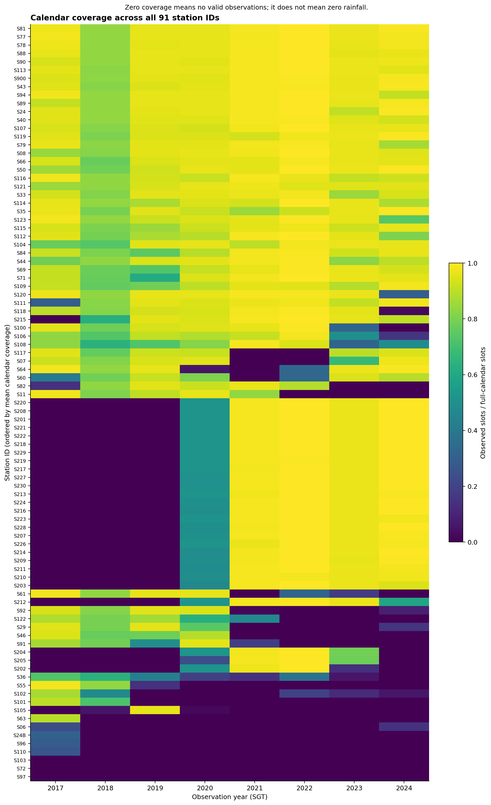
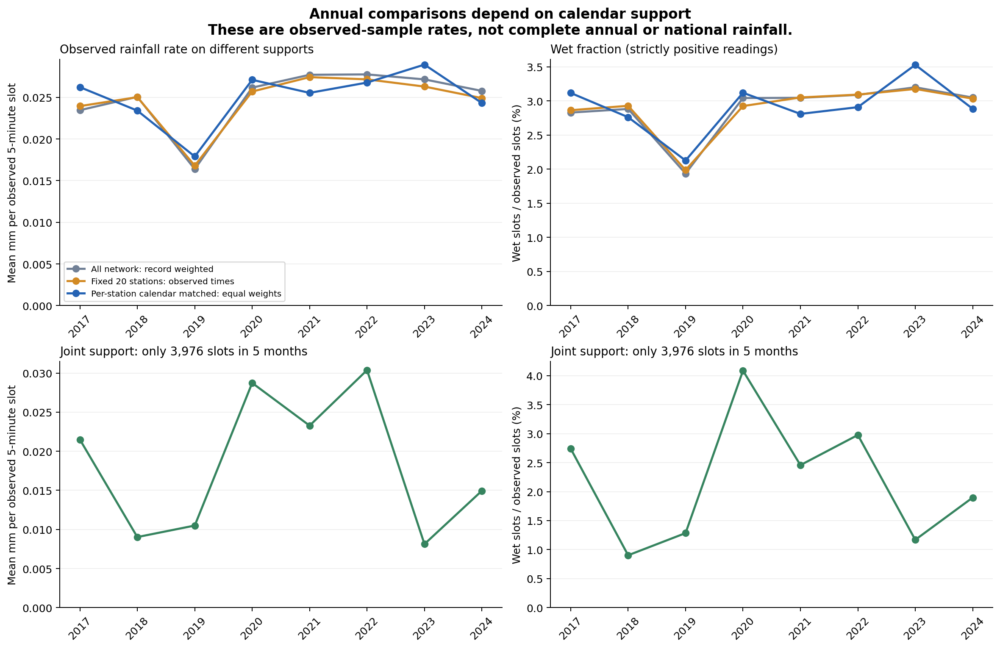
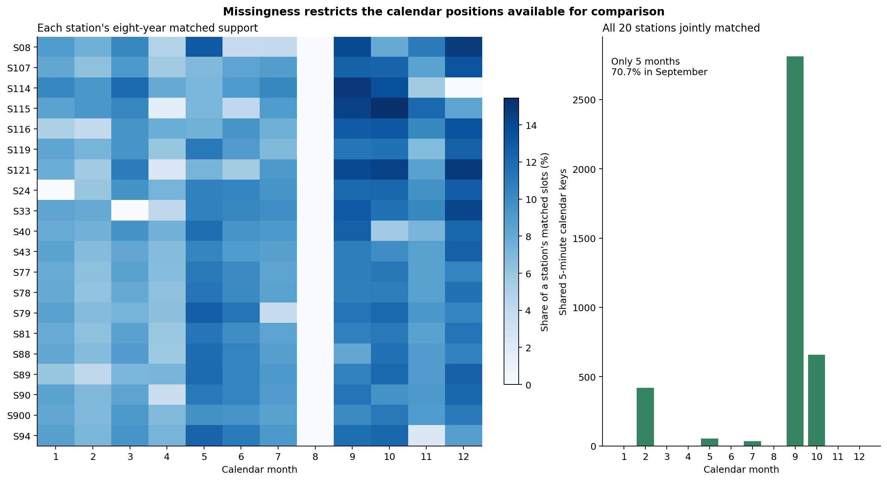
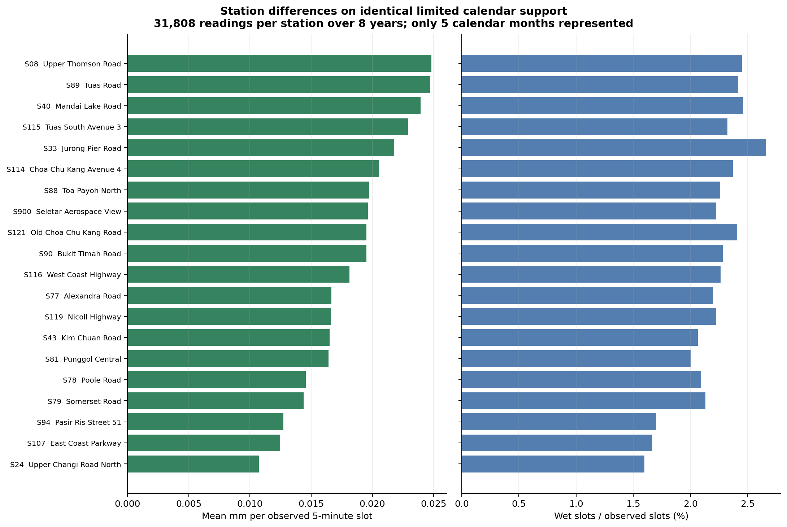
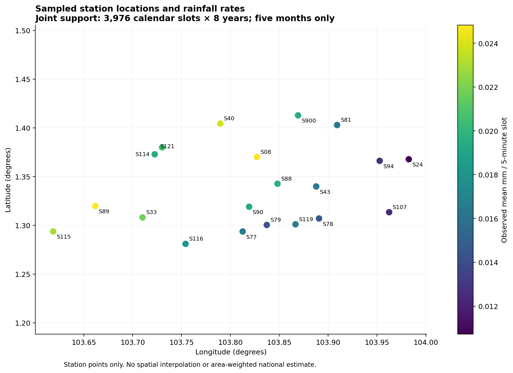
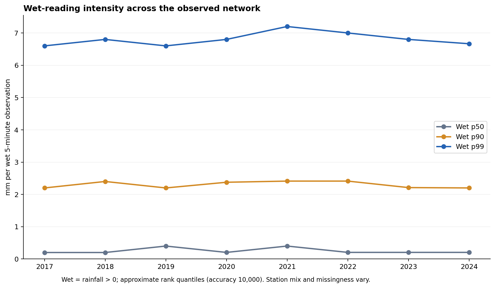

# A report contribution: data, quality and cross-year/station analysis

## 1. Data source and dataset overview

We use the 2017–2024 annual files from NEA's Historical Rainfall across Singapore collection on data.gov.sg. The publisher specifies ISO 8601 timestamps in Singapore Time and cautions that records can be missing and do not receive the quality-control procedures used for official climate records. Our analysis therefore describes this historical dataset rather than replacing official climate statistics. [NEA collection and disclaimer](https://data.gov.sg/collections/2279/view)

The frozen local snapshot comprises 48,538,713 CSV records (8,047,044,701 bytes), with twelve source fields covering observation/update timestamps, station identifiers and names, coordinates, rainfall amount, type and unit. Each annual file has a dataset ID, download record, actual row count, size and locally computed SHA-256. Local digests support reproducibility; they are not publisher-issued CSV hashes. The actual downloaded export sizes differ from the catalogue's displayed sizes, so we audit downloaded bytes and logical records separately. The source links are listed at the end of this contribution.

After cleaning, the formal data contain 48,538,625 unique station/time observations across 91 recorded station IDs, in 96 Parquet files partitioned by SGT observation year and month (4,223,822,379 bytes). The unique key is station_id plus observation_time. Original strings, original timestamps, source year, adjustment amount and source-record digest remain available for tracing decisions. Field definitions are provided in [the formal v1.0 contract](DATA_CONTRACT_V1.md).

## 2. Computing environment and reproducibility

Full-data parsing, cleaning, joins, coverage calculations and statistical aggregation use Apache Spark/PySpark 3.5.8. The local machine runs macOS 26.1 ARM64 with ten physical/logical CPU cores and 16 GiB RAM. Python is 3.11.14; the tested JVM is Eclipse Temurin 17.0.20.1+1. Spark runs as local[4] with a verified 4 GiB JVM maximum heap, Asia/Singapore session time zone, and adaptive query execution enabled. Stage 1 uses 16 shuffle partitions; full-data Stage 2/3 operations use 64. There are no remote worker nodes. Python dependencies are pinned; the relevant packages include NumPy 1.26.4, pandas 2.2.3, PyArrow 17.0.0 and Matplotlib 3.9.2.

Only bounded samples and small aggregate tables are read into Python memory for independent checking or plotting. No full raw or cleaned observation table is loaded into pandas. Formal rainfall amounts use Decimal(20,9); exact sums and boundary comparisons are maintained before any conversion required for plots or model vectors.

Recorded production timings on this machine are 179.56 seconds summed across the eight annual parse jobs, 378.58 seconds for cleaning, 43.06 seconds for quality outputs, and 35.23 seconds for the Stage 3 analysis job. These measure different jobs, include their recorded execution conditions, and exclude some input hashing, downloading, support probing, plotting and independent checks. They must not be combined into an end-to-end runtime or compared directly with model-training time. Installation and the ordered raw-to-figure workflow are in [README](../README.md) and [the run guide](RUN_GUIDE.md). The environment was tested on this Mac; portability checks relocate the sample on the same machine and do not establish successful installation on B/C's computers.

## 3. Data cleaning and quality assessment

Time normalization preserves exact five-minute timestamps. Records exactly one second before a boundary move forward by one second, with the original time and adjustment retained; other offsets are subject to quarantine. All 1,775,327 such source offsets occur in 2017, and 1,775,241 adjusted canonical rows remain. This rule is based on the observed timestamp pattern, not indiscriminate rounding.

At each normalized station/time key, compatible source variants are reduced to one deterministic representative. The data have no completely identical duplicates under the retained source-field definition. We remove 84 compatible redundant rows and quarantine 4 rows in two coordinate-conflict keys for S113; the coordinates differ by about 38.59 metres, while both readings are zero. The observed invalid-record quarantine has 0 rows. No missing timestamps are generated, interpolated or set to zero, and large rain readings are retained with diagnostic flags.

The record ledger is 48,538,713 = 48,538,625 + 84 redundant + 4 quarantined records. The exact cross-station audit amount is 1228212.229440000 = 1228210.429440000 + 1.800000000 + 0 quarantined mm. This accounting sum tracks record transformations across gauges; it is not rainfall over Singapore and has no area-average interpretation.

Calendar coverage uses 288 timestamp slots per day, 105,120 per non-leap year and 105,408 in 2020/2024. Observed-span coverage is separately defined between a station's first and last available observation, inclusive. Outside that span, the station's operating status is unknown: first/last appearance does not prove commissioning or retirement. Station name/device/location combinations are reported, without inferring an unrecorded operational history.

There are 195,591 internal gaps totalling 7,514,757 missing five-minute slots, including 37 gaps across a year boundary and 11,920 gaps with at least sixty missing minutes. Across the full dataset, 63 complete SGT timestamp dates have no valid readings; 39 are in 2018, including 4–31 August. Every station's 2018 calendar coverage is below 90%. An observed zero is a dry reading; a nonexistent record has unknown rainfall. An unobserved station-year has zero observations and null rainfall/rate, rather than an inferred zero-rainfall year.

**Figure A1.** Calendar coverage of 91 station IDs in 2017–2024. Denominators are 105,120 five-minute timestamp slots per non-leap year and 105,408 in 2020/2024. Zero observed coverage means no valid observations, not zero rainfall.

## 4. Interannual rainfall patterns

We first report all available network records, then distinguish station composition from time support. A descriptive cohort requires calendar coverage of at least 80% in each of the eight years and one recorded coordinate combination. This yields twenty stations. Threshold sensitivity yields thirty stations at 70%, twenty-six at 75%, twenty at 80%, and none at 90% or 95%. The cohort rule uses coverage, not rainfall ranking; it remains a descriptive all-years selection and is not a forecasting training-station rule.

For the primary comparison, each station retains month-day/time keys observed in all eight years, excluding 29 February. Each station has 50,641–75,843 shared positions; the combined panel has 1,318,195 readings per year and 10,545,560 over all years. Station-year observed mean rainfall and wet fractions are averaged with equal station weights. Wet means strictly greater than zero. Each station's support is fixed across years, but supports differ across stations and cover only ten to twelve months with uneven month weights. Matching controls the selected calendar positions; it does not recover randomly or systematically missing rain.

| Year | Equal-station mean mm / observed 5-min slot | Wet fraction | Observations |
|---|---:|---:|---:|
| 2017 | 0.026230 | 3.117% | 1,318,195 |
| 2018 | 0.023412 | 2.761% | 1,318,195 |
| 2019 | 0.017900 | 2.127% | 1,318,195 |
| 2020 | 0.027109 | 3.119% | 1,318,195 |
| 2021 | 0.025542 | 2.810% | 1,318,195 |
| 2022 | 0.026779 | 2.908% | 1,318,195 |
| 2023 | 0.028935 | 3.529% | 1,318,195 |
| 2024 | 0.024325 | 2.884% | 1,318,195 |

On this selected station-specific matched support, 2023 has the highest observed mean rate (0.028935 mm per five-minute slot) and 2019 the lowest (0.017900). The highest year changes with support: 2022 for the unbalanced network, 2021 for the fixed cohort at available times, and 2023 for the primary matched panel. A restricted joint panel described below peaks in 2022 and has its lowest rate in 2023. These differences caution against treating available-data totals or means as complete national annual rainfall. No long-term climate trend or causal attribution is estimated.

**Figure A2.** Mean observed rainfall per valid five-minute slot and wet fraction under changing network, fixed cohort, station-specific matched calendar and restricted joint support. Primary station-specific comparison uses 20 equal-weighted stations and 1,318,195 observations per year. Joint support covers five months only; neither panel estimates complete national annual rainfall.

**Figure A3.** Availability of eight-year shared calendar positions by month. Each station has its own shared positions; the joint panel has 3,976 positions in February, May, July, September and October, with 70.7% in September. This figure describes observation support, not a monthly rainfall climatology.

## 5. Differences across monitoring stations

Joint support across all twenty stations and all eight years contains 3,976 calendar positions in February, May, July, September and October; 70.7% lie in September. It fails the pre-specified twelve-month condition for the primary annual comparison and is used only as a restricted spatial diagnostic. Each station has 31,808 joint-support readings across eight years. S08 (Upper Thomson Road) has the highest pooled observed rate (0.024830 mm per slot), and S24 (Upper Changi Road North) the lowest (0.010714). Under wider but station-specific supports, S33 instead ranks highest. Both the calendar restriction and equal exposure must accompany any ranking.

The supplementary rank tables compare all twenty stations on the identical 3,976 positions per year, with average ranks for tied amounts. Across the 28 year pairs, Spearman rank correlation ranges from -0.170 to 0.577. S08's individual-year rank ranges from 1 to 11; pooled first place is therefore not an invariant annual rank. The annual first-place stations are: 2017: S43; 2018: S90; 2019: S116; 2020: S89; 2021: S08; 2022: S40; 2023: S119; 2024: S89. These are descriptive checks on the five-month support; no significance test, full-season rank stability or spatial causal explanation is claimed. Detailed tables are in artifacts/stage5/station_rank_by_year.csv, station_rank_summary.csv and rank_correlations.csv.

**Figure A4.** Station mean rainfall and wet fraction on the same 3,976 calendar positions in each of eight years: 31,808 readings per station. S08 and S24 are the highest and lowest pooled mean rates on this restricted five-month support; ranking is not a full-year spatial result.

**Figure A5.** Longitude/latitude of the descriptive cohort, coloured by observed mean rainfall on restricted joint support. Markers are station measurements; no interpolation or spatial area weighting is applied.

Conditional wet p50/p90/p99 use percentile_approx with accuracy 10,000. The approximation concerns rank; it is not a confidence interval or a bound on missing-data uncertainty. [Spark 3.5.8 percentile_approx documentation](https://spark.apache.org/docs/3.5.8/api/python/reference/pyspark.sql/api/pyspark.sql.functions.percentile_approx.html) Network wet fractions are approximately 1.94%–3.20%, and conditional five-minute p99 values approximately 6.6–7.2 mm; neither describes the future thirty-minute target.

Ten readings at least 20 mm per five minutes remain in the cleaned data. They total 244.8 mm as a diagnostic record sum, with a maximum annual audit-amount share of 0.0779%. Exclusion is a sensitivity diagnostic only and reduces both sum and observation count. The primary panel includes just one of these readings, S33's 26.4 mm in 2021. Excluding it changes the equal-station rate by at most 0.0852% and does not change the year ordering. This does not establish the meteorological validity of extreme readings.

**Figure A6.** Network conditional wet-reading p50/p90/p99 by year, using strictly positive five-minute amounts and percentile_approx with accuracy 10,000. Approximation concerns rank; these are not thirty-minute future-label quantiles and not estimates of missing-data uncertainty.

## 6. Limitations, validation and AI use

The interval-end interpretation (t−5 min, t] remains an explicitly stated research convention, not an officially established historical timestamp definition. Timestamp-date coverage and a meteorological daily rainfall total are different constructions, particularly at midnight. Update fields are not confirmed first-availability times; historical revisions cannot be replayed from this snapshot. Offline results cannot alone establish operational information availability or live prediction performance.

Nonrandom missingness, instrument calibration and unrecorded station changes remain unresolved. The eight-year observation window and selected supports cannot identify a long-term climate trend. Gauges have no spatial area weights, so station millimetres are not summed or interpolated into national rainfall. No observed sums are simply divided by coverage to impute full annual totals. The descriptive cohort uses 2024 availability and must not be automatically adopted for model selection. B/C must fit preprocessing and selection only within their training data.

Independent acceptance checks reconcile source fingerprints and exact count/amount ledgers, coverage denominators and per-station gap totals, formal sample values, both matched panels against actual observations, equal-station weighting and empirical wet-quantile rank bounds. Stage 1 has five source-integrity tests; Stage 2 has nine cleaning-boundary tests and eight acceptance checks; Stage 3 has six analytical-boundary tests and eleven acceptance checks. Stage 4 verifies A's ordered run entry, actual environment, real sample read/write flow and delivery inventory. These are automated Codex-assisted checks. B's label/features implementation and C's actual model loading/prediction have not been supplied or tested at the time of this contribution.

**AI-use statement for the group to review:** Codex/ChatGPT assisted with understanding the project and responsibility split, locating official sources, drafting processing/checking scripts and documentation, executing local Spark analyses, and generating report text and Matplotlib figures. Automated checks and Codex visual inspection were recorded. They are not claims of human meteorological validation or independent group-member review. The final submitted statement should add only the human review and edits actually performed by the group, and the actual model-development assistance used by B/C. [AI activity record](AI_USAGE.md)

## Source and evidence links

- [2017 annual source](https://data.gov.sg/datasets/d_1990a5a1aeaf3dd243cf4dae294a61c4/view)
- [2018 annual source](https://data.gov.sg/datasets/d_024fb501ce7092b71bb713eaf54fa7eb/view)
- [2019 annual source](https://data.gov.sg/datasets/d_61995f092320e7155b7528050880b502/view)
- [2020 annual source](https://data.gov.sg/datasets/d_9e7de44094f876f6804b8b5bcee45c81/view)
- [2021 annual source](https://data.gov.sg/datasets/d_3b41598f74f1f11fc3430348fea51af5/view)
- [2022 annual source](https://data.gov.sg/datasets/d_42d64cc6c176ace1c52fbb40b9ede302/view)
- [2023 annual source](https://data.gov.sg/datasets/d_f864cc30d58b467db83659ad17c737bf/view)
- [2024 annual source](https://data.gov.sg/datasets/d_a0b69d3e02576a1fd0ab673e71f83507/view)

- [Source manifest](../data/data_manifest.csv), [Stage 2 quality report](../artifacts/stage2/STAGE_2_CHECK_REPORT.md), [Stage 3 analysis](STAGE_3_ANALYSIS.md).
- [Figure captions](../artifacts/stage5/figure_captions.csv), [report facts](../artifacts/stage5/report_facts.json), [B merge guide](REPORT_A_MERGE_GUIDE.md).

This is A's report contribution. Within-year rainfall analysis, threshold-target distributions, baselines, main model/evaluation and final PDF assembly belong to B/C and should be merged only from their actual delivered results.
